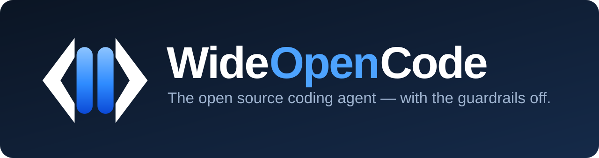

<div align="center">
  

  <p><strong>The open source OpenCode agent, just with the guardrails off.</strong></p>
  <p>A friendly fork of <a href="https://github.com/anomalyco/opencode">opencode</a> that says yes.</p>

  <p>
    <a href="LICENSE"></a>
    
    
    <a href="../../releases/latest"></a>
    <a href="CONTRIBUTING.md"></a>
  </p>
</div>

---

Hi, you found us. 👋

**WideOpenCode** is [opencode](https://github.com/anomalyco/opencode), the open source AI coding
agent, with two deliberate changes:

1. **The guardrails are gone.** The system prompts no longer tell the model to refuse, lecture or
   moralize. It just helps with what you asked for, including security research and other dual-use
   work.
2. **It has a name and a face.** The command is `wideopencode`, the desktop app is titled
   **WideOpenCode**, so you always know exactly what you're running.

Everything else, including providers, models, the TUI, the desktop app and the SDK, is upstream
opencode, kept in sync automatically. We're a thin, honest layer, not a rewrite.

> [!IMPORTANT]
> **This is a personal project.** WideOpenCode is built and maintained by
> [@judggernaut](https://github.com/judggernaut) in a personal capacity. It is **not** affiliated
> with, endorsed by, sponsored by or supported by GitHub, Inc., and nothing in this repository
> represents the views, positions or practices of GitHub or its employees. See
> [DISCLAIMER.md](./DISCLAIMER.md).

> [!NOTE]
> WideOpenCode is a fork, not a vendored copy. We track upstream closely, so you get the newest
> opencode features within hours. See [MAINTENANCE.md](./MAINTENANCE.md) if you're curious how.

## Install

### CLI

Grab the binary for your platform from the [latest release](../../releases/latest):

```sh
# macOS (Apple Silicon)
curl -L https://github.com/judggernaut/WideOpenCode/releases/latest/download/wideopencode-darwin-arm64 -o wideopencode && chmod +x wideopencode && sudo mv wideopencode /usr/local/bin/

# macOS (Intel)
curl -L https://github.com/judggernaut/WideOpenCode/releases/latest/download/wideopencode-darwin-x64 -o wideopencode && chmod +x wideopencode && sudo mv wideopencode /usr/local/bin/

# Linux (x64)
curl -L https://github.com/judggernaut/WideOpenCode/releases/latest/download/wideopencode-linux-x64 -o wideopencode && chmod +x wideopencode && sudo mv wideopencode /usr/local/bin/
```

Then, in any project:

```sh
wideopencode
```

### Desktop

Installers live on the [releases page](../../releases/latest): `.dmg` and `.zip` for macOS, `.exe`
for Windows and `.AppImage`, `.deb` or `.rpm` for Linux.

The builds are **unsigned** (a fork has no Apple or Windows signing certificates), so your OS will
warn the first time. On macOS, after dragging it to Applications:

```sh
xattr -cr /Applications/WideOpenCode.app
```

## Quick start

1. Install the CLI (or desktop app) above.
2. Run `wideopencode` inside a project and connect a provider with `/connect`.
3. Ask it something. It will help. That's the whole trick.

New to agents? Hit **Tab** to switch to Plan mode and ask it to sketch an approach before it writes
any code.

## What's different from opencode?

| | opencode | WideOpenCode |
| --- | --- | --- |
| Refuses "sensitive" requests | sometimes | never |
| Command | `opencode` | `wideopencode` |
| Desktop app | OpenCode | WideOpenCode |
| Everything else | ✅ | same as upstream |

We keep the internal machinery (protocol scheme, config paths, storage) aligned with upstream on
purpose, which means fewer surprises and faster syncs. [MAINTENANCE.md](./MAINTENANCE.md) lists the
full diff.

## FAQ

**Is this just opencode with a prompt change?**
Basically, yes, and that's the point. opencode is excellent. We keep it excellent, minus the
refusals, plus a name you can recognize.

**Will it stay up to date with upstream?**
Yes. A scheduled workflow merges upstream several times a day and re-applies our changes. If
upstream ever moves something we patch, the build fails loudly instead of shipping something wrong.

**Does it phone home?**
It behaves like upstream opencode. We don't add telemetry, and we don't strip the user-facing
features (models catalog, sharing, updates) that you might actually want.

**Is it safe or legal to use?**
It's a tool. You're responsible for how you use it. See the disclaimer below.

**Can I contribute?**
Please. Start with [CONTRIBUTING.md](./CONTRIBUTING.md). Be kind, and read our
[Code of Conduct](./CODE_OF_CONDUCT.md).

## Community

- 🐛 [Report a bug or request a feature](https://github.com/judggernaut/WideOpenCode/issues)
- 💬 [Discussions](https://github.com/judggernaut/WideOpenCode/discussions)
- 🤝 [Contributing guide](./CONTRIBUTING.md), [Code of Conduct](./CODE_OF_CONDUCT.md) and [Support](./SUPPORT.md)

## Credits

WideOpenCode stands entirely on the shoulders of [opencode](https://github.com/anomalyco/opencode)
and its contributors. Huge thanks to everyone who builds and maintains it. If you like this project,
go star upstream.

## License

[MIT](./LICENSE), same as upstream opencode.

## Disclaimer

**WideOpenCode is a personal project.** It is created and maintained by
[@judggernaut](https://github.com/judggernaut) on personal time and hardware. It is **not** a GitHub
product or project. It is not affiliated with, endorsed by, sponsored by, reviewed by or supported
by GitHub, Inc. in any way, and it does not represent the views, opinions, positions or practices of
GitHub or any of its employees. All opinions expressed here are the author's own.

"GitHub" and "GitHub Copilot" are trademarks of GitHub, Inc. "opencode" is a project of
[Anomaly](https://github.com/anomalyco). This project is an independent fork and is not affiliated
with either.

Provided for educational and research purposes. WideOpenCode removes built-in refusals from the
agent's system prompts. It does not change what any model or provider will actually do. You are
responsible for your use of it. See [DISCLAIMER.md](./DISCLAIMER.md) for the full text.
